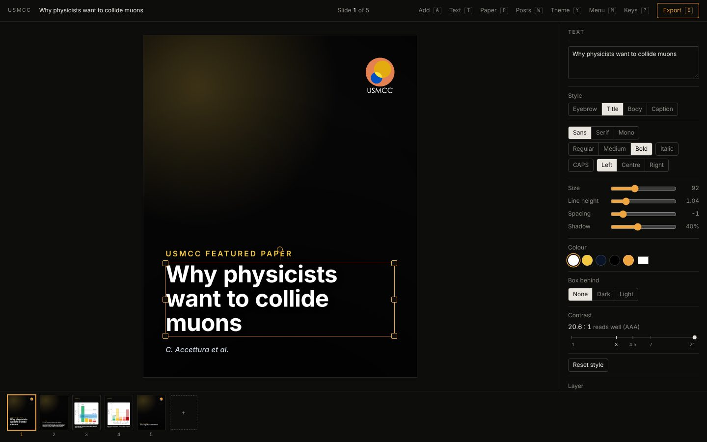

# USMCC Publicity Helper

When a US Muon Collider Collaboration paper comes out, this turns it into a
post: a **carousel of slides** in the collaboration's look, and the words for
X, Bluesky, LinkedIn and the website.

Paste the paper's row from the submission sheet (or just its arXiv link), make
the slides, pull in photos, plots, pages of the PDF or the paper's own
figures from arXiv, edit, and export. On a phone, the slides go straight to
the camera roll, in order, ready to post.

**[Website](https://lawrenceleejr.github.io/USMCCPaperPublicityHelper/)** ·
**[Download](https://github.com/lawrenceleejr/USMCCPaperPublicityHelper/releases/latest)** ·
**[In the browser](https://lawrenceleejr.github.io/USMCCPaperPublicityHelper/lite/)** (phones too)



## What it does

- **The paper in one paste.** A row copied from the submission sheet (with or
  without its header) fills in the title, plain title, authors, date,
  summary and link. Or paste just an arXiv link: the desktop app fills in
  the title, authors, date and abstract from arXiv. LaTeX in titles and
  abstracts (`$\tau$`, `$10^{34}$`) comes out as readable text (τ, 10³⁴).
- **Make slides.** A cover ("USMCC Featured Paper", title, authors, logo), a
  plain-language summary and a closing slide with the link and a QR code to
  the paper (links in Instagram posts can't be tapped), in the current
  theme. Long titles shrink to fit. The text re-stacks itself when you change the theme or the size, or
  edit the words, until you move it by hand.
- **Pictures of every kind.** Photos fill a slide (behind the words); plots
  (PNG, SVG, PDF) sit on a white card; pages of a PDF are picked from
  thumbnails; the paper's figures come straight from its arXiv source, in
  reading order, with their captions from the paper (PDF figures drawn
  sharp). Each figure gets its own slide: label, picture, caption, logo. Drop files anywhere, paste them, or press `A`.
- **Simple edits.** Move, resize and turn anything (with snapping to the
  centre and the margins); crop and zoom a picture inside its frame, to the
  one panel of a plot that matters; brightness, contrast, saturation,
  warmth; rounded corners.
- **Text.** Eyebrow, title, body and caption styles from the theme, or your
  own size, font, weight, colour, alignment, shadow and a box behind. A
  contrast readout (WCAG, on a log scale) says when text gets hard to read
  over a photo.
- **Carousels that flow.** The theme's backdrop (its gradient and soft
  light) is one piece across all the slides, so they join without a seam
  when swiped. A figure or photo can be the background too, running behind
  any number of slides: plots glow on dark themes (inverted, colours kept)
  and print into light ones; or duotone, mono, as is, with strength and
  blur. **Make slides** puts one of the paper's figures behind the carousel,
  crossing from the cover into the next slide. **Preview** (`V`) shows the
  slides side by side, swipeable on a phone.
- **Six academic themes**, each with its own Google Fonts pairing, and three
  sizes (portrait 4:5, square, story 9:16): Midnight (Instrument Serif +
  Source Serif), Paper (Newsreader), Blueprint (IBM Plex, on a grid), Ink
  (Fraunces + Inter), Glacier (Manrope), Signal (Anton). Folios ("02 / 05")
  and hairline rules; plots on white join the slide instead of sitting on a
  card. The fonts ship with the app, so it works offline. Text is sized to
  read on a phone.
- **Export** JPEGs or PNGs (1080 px wide) for Instagram, X and Bluesky, or one
  PDF for a LinkedIn document post. Desktop: into a folder. Phone: the share
  sheet, **Save Images** → Photos.
- **Posts.** Drafts of the X post (and thread), Bluesky and LinkedIn posts, a
  plain-language summary and the website's Hugo `index.md`, with a length
  gauge for each against the platform's limit. In the desktop app Claude can
  write them (your API key stays in the system keychain).
- **Undo** everything (`⌘Z`), and every carousel is kept: `O` lists them.

## Install

| | Download | First launch |
|---|---|---|
| **macOS** (Apple silicon) | `USMCC-Publicity-Helper-macOS-AppleSilicon.dmg` | Right-click the app → **Open** → **Open**. If macOS says it's damaged, run `xattr -cr "/Applications/USMCC Publicity Helper.app"` once. |
| **macOS** (Intel) | `USMCC-Publicity-Helper-macOS-Intel.dmg` | Same as above. |
| **Windows** | `USMCC-Publicity-Helper-Windows-Setup.exe` | If SmartScreen appears: **More info** → **Run anyway**. |
| **Linux** | `USMCC-Publicity-Helper-Linux.AppImage` | `chmod +x`, then run it. |

The apps aren't signed by Apple or Microsoft yet, which is why the first
launch needs that extra step.

### In the browser, and on phones

**[The browser version](https://lawrenceleejr.github.io/USMCCPaperPublicityHelper/lite/)**
("Lite") is the same app with nothing to install, on an iPhone, an Android
phone, an iPad or any computer.

- **Phone:** tap **Paper** to paste the row (or an arXiv link) and **Make
  slides**; **Add** for photos (from Photos or Files); **Preview** to swipe
  through the carousel as it will look; **Export** then **Save Images** to
  put the slides in Photos. Tap something to select it (the bar above the
  slides has its main actions; **More** for the rest), drag with a finger,
  pinch to resize and turn, **Edit** opens text full screen. A swipe across
  the slide (or its background) goes to the next slide. Share → **Add to Home Screen** keeps it like an app,
  offline too.
- **Computer:** Chrome and Edge export into a folder you choose; other
  browsers save to Downloads. All the keys work.

Carousels and pictures stay on the device; nothing is uploaded. Lite drafts
the posts from the paper; writing them with Claude is in the desktop app,
which keeps the API key in the keychain.

### Without the app window

The same program runs from a terminal and opens in your browser:

```bash
usmcc --serve            # [--port 4880] [--no-open]
```

On macOS the program is inside the app:
`/Applications/USMCC Publicity Helper.app/Contents/MacOS/usmcc`. Small
standalone `usmcc-cli-…` builds are on the releases page too.

## Keys

| Key | |
|---|---|
| `A` | add photos, PDFs, plots, or a paper's source (`.tar.gz`) |
| `P` | the paper: paste its row or arXiv link; figures and PDF pages |
| `W` | write the posts |
| `E` | export |
| `T` / `L` | add text / the logo |
| `[` `]` or `←` `→` | previous / next slide (arrows move the selected layer; `⇧` by 10) |
| `N` / `D` / `⌘⌫` | new / duplicate / delete slide; `{` `}` move it |
| `C` | crop the selected picture (drag to pan, scroll to zoom) |
| `B` / `R` / `X` | fill or fit the frame / turn 90° / use as the background (and back) |
| `K` / `V` | add a background picture / preview the carousel, slides joined |
| `,` `.` | send backward / bring forward |
| `Tab`, `Enter`, `⌫` | select the next layer, edit text, delete |
| `⌘D` | duplicate the layer |
| `Y` / `S` | theme and size / next size |
| `G` / `F` | safe-area guides / full screen |
| `O` | your carousels |
| `⌘Z` / `⇧⌘Z` | undo / redo |
| `M` / `?` | the menu / every key |

Every tool is also in the **Menu** and, on macOS, the menu bar.

## For developers

Built like [Brackit](https://github.com/lawrenceleejr/Brackit): a small Rust
program (`src-tauri/`) serves a plain HTML/CSS/JS page (`web/`, embedded in
the binary) and a JSON API, shown in a [Tauri](https://tauri.app) window. The
paper-handling code (`src-tauri/src/paper.rs`: sheet rows, arXiv ids, figure
extraction from a paper's source, post drafts) is also compiled to
WebAssembly for Lite, where `web/lite.js` answers the API in the browser.
The website is in `site/` (Hugo).

```bash
npm install
npm run app          # the app
npm start            # the browser version of the desktop app
npm run lite         # build Lite into build/lite and serve it
cargo test --no-default-features --manifest-path src-tauri/Cargo.toml
npm run build:cli && npm test && npm run test:ui
```

`npm run samples` builds carousels from six real muon collider papers
(`tests/fixtures/papers.tsv`, with their figures from arXiv) in every theme
and lays the slides out on one contact sheet, `build/samples/contact.png`,
for checking the design. `node scripts/fetch-fonts.mjs` refreshes the fonts.

`test:ui` drives the editor in headless Chromium (building a carousel,
exports, undo, a 50 ms budget for key presses) and checks that Lite reads
rows, arXiv links and paper sources exactly as the desktop does, and works by
touch on a phone. `rustup target add wasm32-unknown-unknown` is needed for
Lite. See `CLAUDE.md` for notes on working on the code. Pushing a tag like
`v0.2.0` builds every platform and publishes a release.
